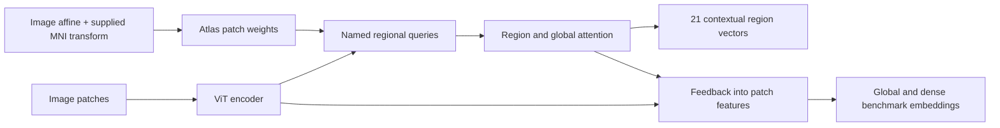

# Named contextual region embeddings

The `main-regions` and `ryan-regions` checkpoints implement the user's proposed region tokens. Both expose the same method, `forward_region_embeddings`, returning 21 named 768-dimensional vectors plus a Boolean availability mask. Left and right hippocampus are separate entries.

Each region starts with a learned identity vector plus atlas-weighted patch evidence. Its first attention operation is restricted to patches supported by that region's anatomical prior; subsequent attention exchanges information among available regions and a global brain token. A learned residual feeds that context back into patch features, so the existing global and dense benchmark outputs also depend on the region module. The returned vector therefore depends on the scan, its local anatomy and its wider brain context; the region's name alone does not identify anatomy.



Use the **matching worktree's source code** when restoring its checkpoint. From the repository root, for example:

```bash
PYTHONPATH=branches/ryan-regions/src .venv/bin/python your_analysis.py
```

In `your_analysis.py`:

```python
import nibabel as nib
import numpy as np
import torch
from nanobrain.model import vit_mae_3d

checkpoint = "/data/hassan/nanobrain/anatomical-regions-20261109/ryan-regions/checkpoint-last.pth"
model = vit_mae_3d(checkpoint=checkpoint).cuda().eval()
sample = {
    "image": nib.load("scan.nii.gz"),
    "brain_mask": nib.load("brain_mask.nii.gz"),
    # Original image-world RAS mm -> MNI152NLin6Asym world RAS mm.
    "mni_affine": np.load("mni_affine.npy"),  # shape (4, 4)
}
prepared = model.transform(sample)
with torch.inference_mode():
    result = model.forward_region_embeddings([prepared])[0]

index = result["names"].index("left_hippocampus")
if result["available"][index].item():
    hippocampus_context = result["embeddings"][index]  # shape (768,)
    print(hippocampus_context.shape)
```

Brainmarks already supplies the required `image`, `brain_mask` and `mni_affine` fields. For new external scans, a valid registration in the stated coordinate convention is required; an identity matrix is not a general substitute. The atlas is stored inside each checkpoint, so restoring it does not require downloading the atlas again.

The names come from the Harvard–Oxford atlas, not an inferred textual vocabulary. They include hippocampus, amygdala, thalamus, caudate, putamen, pallidum, accumbens, lateral ventricle, cerebral cortex and cerebral white matter separately for each hemisphere, plus brainstem. The cortex labels are broad hemispheric regions, not a detailed cortical parcellation.

Treat the vectors as learned representations, not measurements of hippocampal volume or evidence that each region's boundaries are correct. Membership uses a population atlas, affine registration, coarse image patches and an eight-point overlap approximation. Unavailable regions return zero vectors and `available=False`; do not treat those zeros as observed anatomy. The consistency and coverage experiments intentionally omit learned regional queries so each experiment isolates one proposed change.
